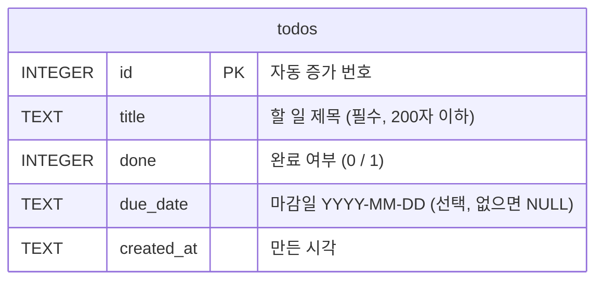
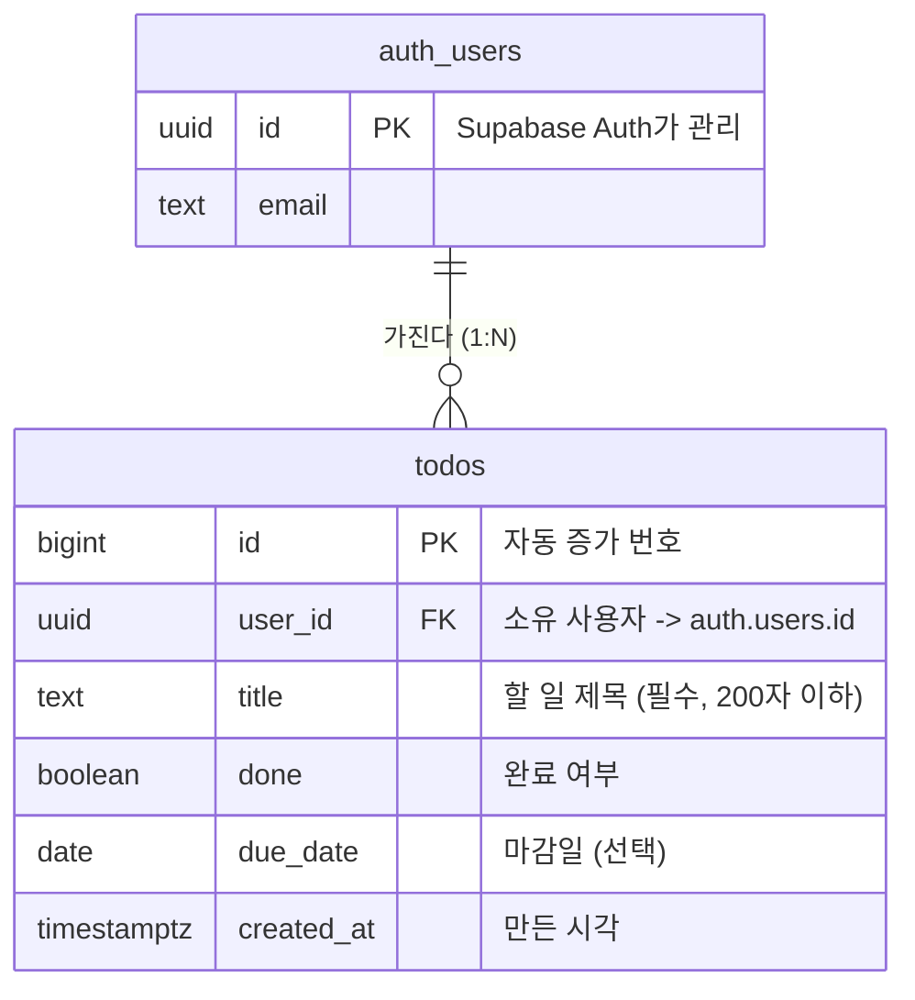

# DB 구조도 - 내 Todo 앱

PRD 기준으로 저장할 표·열·관계를 정리한 설계도입니다.

## 1. 저장할 것
- **할 일(todos)** 하나뿐입니다. 마감일과 '오늘 할 일만 보기'는 별도 표 없이 `todos.due_date` 열 하나로 해결됩니다.
- 길 B에서는 **사용자(users)** 가 생기지만, 회원 표는 직접 만들지 않고 Supabase Auth가 관리하는 `auth.users`를 그대로 씁니다.

## 2. 구조도

### 길 A - 로컬 SQLite (`todo.db`)
로그인이 없으므로 표 하나로 끝납니다.

### 길 B - Supabase (Postgres)
`user_id` 열이 추가되어 **사용자 1명 : 할 일 N개 (일대다)** 관계가 됩니다.

## 3. 열 설명

| 열 | 로컬(SQLite) | 클라우드(Postgres) | 규칙 |
|---|---|---|---|
| `id` | INTEGER PK AUTOINCREMENT | bigint identity PK | 할 일을 구분하는 번호(키) |
| `user_id` | 없음 | uuid, `auth.users(id)` 참조, 사용자 삭제 시 함께 삭제 | 길 B에서만. RLS의 기준 |
| `title` | TEXT NOT NULL | text NOT NULL | 공백 불가, 200자 이하 (CHECK + 백엔드 검사) |
| `done` | INTEGER 0/1, 기본 0 | boolean, 기본 false | 완료 표시 |
| `due_date` | TEXT `YYYY-MM-DD`, NULL 가능 | date, NULL 가능 | 마감일 강조 / 오늘 필터에 사용 |
| `created_at` | TEXT, 기본 현재 시각 | timestamptz, 기본 now() | 같은 마감일끼리 정렬 |

**인덱스(색인)** - 길 B에서 `todos(user_id)`에 인덱스를 둡니다. 모든 조회가 "내 할 일만"이라 이 조건으로 빨리 찾기 위해서입니다. 할 일이 적은 로컬에서는 두지 않습니다.

**중복 확인(정규화)** - 같은 정보가 여러 곳에 적히지 않습니다. 사용자 이메일은 `auth.users`에만 있고, `todos`에는 `user_id`만 둡니다.

## 4. CRUD를 SQL로 풀면
`?`는 파라미터 자리입니다. 사용자 입력을 SQL 문자열에 직접 붙이지 않습니다(SQL 주입 방어).

| 기능 | SQL |
|---|---|
| 추가 | `INSERT INTO todos (title, due_date) VALUES (?, ?)` |
| 목록 | `SELECT * FROM todos ORDER BY due_date IS NULL, due_date, created_at` |
| 오늘 할 일 | `SELECT * FROM todos WHERE due_date = ?` (오늘 날짜를 파라미터로) |
| 완료 표시 | `UPDATE todos SET done = ? WHERE id = ?` |
| 삭제 | `DELETE FROM todos WHERE id = ?` |

'오늘 할 일' 쿼리를 말로 하면: "할 일 표(FROM todos)에서 마감일이 오늘인 것(WHERE due_date = 오늘)의 모든 항목(SELECT *)을 가져와."

## 5. 길 B 보안 - RLS 정책
RLS를 켜고, 모든 동작에 같은 규칙을 겁니다: **`auth.uid() = user_id`인 행만** 허용합니다.

| 동작 | 정책 |
|---|---|
| SELECT (조회) | 내 행만 보인다 |
| INSERT (추가) | `user_id`를 내 id로만 넣을 수 있다 |
| UPDATE (수정) | 내 행만 고칠 수 있고, 주인을 남으로 바꿀 수 없다 |
| DELETE (삭제) | 내 행만 지울 수 있다 |

백엔드는 Supabase를 부를 때 **로그인한 사용자의 토큰**을 함께 보냅니다. 그래서 백엔드 코드에 실수가 있어도 DB(RLS)가 다른 사람의 할 일을 막습니다. 모든 권한을 가진 `service_role` 키는 쓰지 않습니다.
